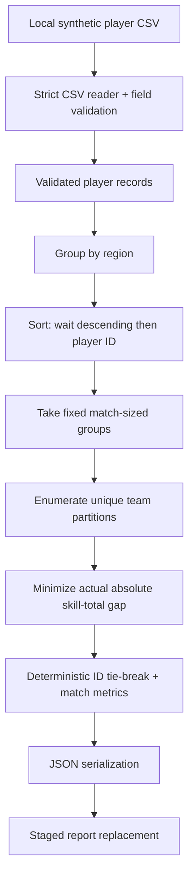

# MatchFair — Engineering case study

**Project:** Offline Python matchmaking simulator · **Scope:** synthetic, region-scoped, two-team matches

[README](../README.md) · [Example player pool](../examples/players.csv) · [Golden sample report](../evidence/sample-match-report.json) · [Queue counterexample](../evidence/queue-tradeoff-report.json) · [CI validation](../evidence/validation.md)

## Engineering problem

"Fair matchmaking" is not one metric. Two teams can have similar total estimated skill even when players have waited different amounts of time, and a simulator that forms matches from a fixed queue order may overlook better skill-balance groupings across a batch boundary.

MatchFair isolates that tradeoff for discussion. Its **region and longest-wait-first grouping policy is fixed**, and it optimizes only the assignment of players to two teams **inside each selected group**. It is not a live matchmaking system, a measured competitive fairness metric, or a Riot Games integration.

## Architecture

| Component | Responsibility |
| --- | --- |
| [`core.load_players`](../src/matchfair/core.py) | Exact header, four columns, row-level diagnostics, duplicate ID and numeric validation |
| [`core._checked_players`](../src/matchfair/core.py) | Validate direct Python callers so they cannot bypass CSV safeguards |
| [`core.balance`](../src/matchfair/core.py) | Unique partition search; exact gap ranking and stable ID tie-break |
| [`core.simulate`](../src/matchfair/core.py) | Region grouping, queue selection, match metrics and report generation |
| [`__main__.py`](../src/matchfair/__main__.py) | CLI argument handling, input/output alias checks, staged output |

## Core decisions and tradeoffs

### Fix the queue batch; optimize only its teams

The simulator sorts a region's players by **wait seconds descending**, breaking ties by player ID. It forms consecutive batches of `2 * team_size` players. Within each batch, it evaluates team assignments, minimizing the absolute difference in **team skill-rating totals**.

This answers a narrow question: *Given the players already selected for this match, which two teams minimize the difference in summed ratings?* It does **not** answer whether the queue ought to select a different group, whether a specific matchmaking outcome is equitable, or whether a match will be fun.

### Remove mirror assignments without missing unique splits

For a batch of `2k` players (team size `k`), placing the first queued player on team A removes duplicate A/B mirror configurations while preserving every unique partition. The search checks **`C(2k−1, k−1)`** candidates; with `k <= 5`, at most **126** candidate assignments are examined per match. Equal actual gaps are broken by the sorted team-A player IDs, making results reproducible even when the CSV order varies.

The previous implementation rounded the gap to nine decimal places **before ranking candidates**, potentially selecting a worse true skill-total gap when differences are tiny. The upgrade compares the underlying numerical gap first and applies the ID tie-break only after an actual tie.

### Validate metrics and do not destroy source data

- The CSV requires exactly `player_id,skill_rating,wait_seconds,region`. It rejects missing/extra columns, duplicate IDs, missing regions, non-finite and negative numbers.
- The Python API independently validates direct records and team-size bounds, rejecting boolean "ratings" and malformed fields.
- Skill totals use `math.fsum`, with a clear error for totals outside the supported finite numeric range.
- The CLI checks for equivalent input/output paths (including existing hard links) and stages a fully encoded report in a temporary sibling file before replacement. This avoids truncation from invalid input and obvious source-file collisions, not all crash or concurrency hazards.

## Reproducible evidence: balanced sample

[Eight fictional players](../examples/players.csv) from EU and NA form **two 2v2 matches**. The alternating-team baseline has skill gaps of **40 and 20 rating points**, respectively (mean 30). Within those fixed batches, MatchFair finds a **zero skill-total gap in both matches** (mean zero).

This is an example in which assignment optimization improves a simple objective. The sample is **not** a prediction of real match quality or measured improvement on a live matchmaking service.

## Reproducible counterexample: queue selection matters

The [queue-order fixture](../examples/queue_tradeoff.csv) forces the longest-waiting four players into the first match and the next four into the second. Under these fixed groups, the best team splits produce **100 rating points of gap in each match**.

A hypothetical cross-batch swap of p03 (60 seconds waited) and p05 (40 seconds waited) could let both groups reach zero skill gap, but it would prioritize a shorter-wait player ahead of a longer-wait one. The simulator does not model player arrivals, wait distributions under a changed policy, roles, premade parties, or real-time queue behavior.

## Validation strategy

The regression suite spans strict CSV parsing, direct API validation, duplicate IDs across regions, incomplete regional pools, deterministic input ordering and tie-breaking, all supported team sizes, tiny skill-gap differences, numeric overflow, and unchanged JSON evidence. CLI subprocess tests cover the sample and queue-counterexample JSON, output staging, input alias safety, hard links, invalid inputs, usage errors, and exit codes.

GitHub Actions runs **Python 3.10, 3.11 and 3.12 on Windows and Ubuntu**. The [validation matrix](../evidence/validation.md) distinguishes verified runs from untested possibilities. Tests demonstrate the behavior of synthetic fixtures, not live matchmaking effectiveness.

## Complexity

Let `n` be the total players, and `k` the team size (1–5).

- Group/sort players by region: **O(n log n)** time overall.
- For each match of `2k` players, enumeration checks **`C(2k−1, k−1)`** assignments; each candidate forms teams and totals their ratings in **O(k)** time.
- Total algorithmic cost: **O(n log n + (n/(2k)) × k × C(2k−1, k−1))** time, with a small bounded search at k≤5.
- Memory: **O(n)** for grouped players and match reports, plus temporary O(k) partition structures.

## Limitations and next experiments

- Skill-total gap is not a universal definition of fairness and does not assess roles, coordination, toxicity, uncertainty, latency, or match outcomes.
- All players for a region must form complete match-sized groups; this is not a general streaming queue model.
- Regions never mix, which simplifies the model but prevents region/latency tradeoff analysis.
- The tool is a local educational simulation with no real player identities, match history, game APIs, or connection to Riot Games.
- Staged output replacement does not provide transactional multi-writer semantics or power-loss durability.
- Next experiments could compare alternative group-selection policies with explicitly defined waiting costs and test simulated arrivals over time.

## Interview-ready summary

> MatchFair is a deterministic Python matchmaking simulation that explores one narrow fairness objective: minimizing the difference in summed skill ratings between two teams. It groups fictional players by region, selects queue batches in longest-wait-first order, and exhaustively searches unique team assignments. I fixed a ranking flaw where rounding could choose an inferior split, strengthened validation for malformed CSVs and direct Python calls, and added reproducible CLI tests against two golden JSON reports. The queue-order counterexample shows why optimizing teams inside a batch is not the same as optimizing which players get selected. It is an offline prototype, not a claim about production matchmaking systems.
